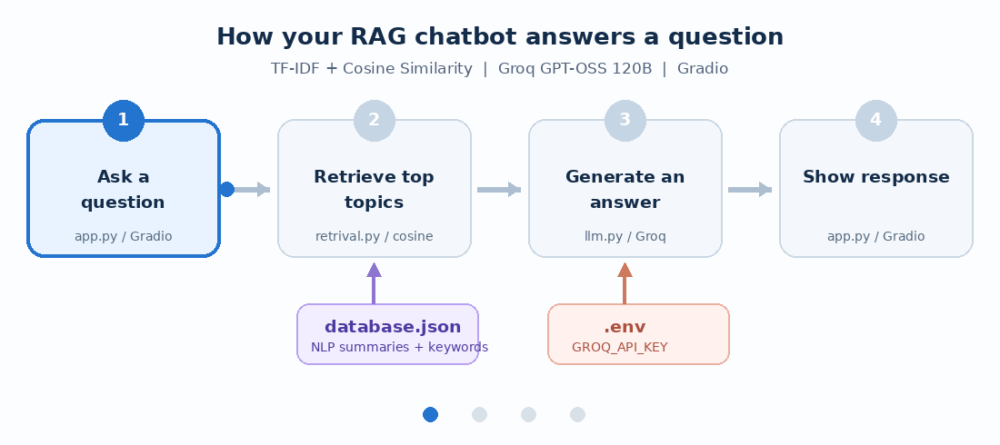
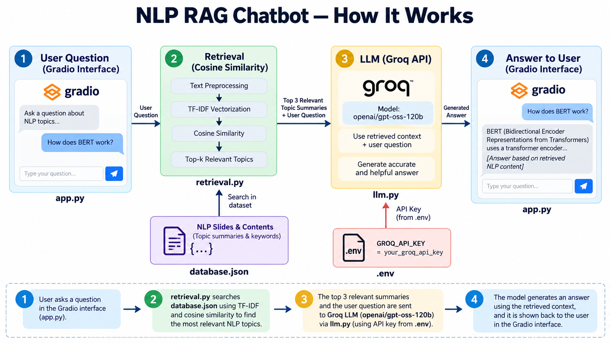

# Simple RAG Chatbot (Groq GPT-OSS 120B)

A **minimal Retrieval-Augmented Generation (RAG)** chatbot for NLP course notes. It searches topic summaries in a local JSON file using **TF-IDF + cosine similarity**, then asks **Groq's `openai/gpt-oss-120b`** model to answer using the retrieved context. The chat UI uses **Gradio**.

No LangChain, Pinecone, Chroma, embedding API, or external database is needed.

## Animated RAG workflow



**How it works**

1. A student asks a question in the Gradio chatbot (`app.py`).
2. `retrival.py` converts the question into a TF-IDF vector and calculates cosine similarity with the NLP topic data from `database.json`.
3. The three highest-scoring topics with a nonzero similarity are sent as context, together with the student's question, to `openai/gpt-oss-120b` through the Groq API (`llm.py`).
4. The model answers using that context, and the answer appears in Gradio.

## Architecture (PNG)



## Project structure

```text
nlp_rag_groq/
├── app.py                 # Gradio chatbot
├── retrival.py            # TF-IDF + cosine similarity retrieval
├── llm.py                 # Groq GPT-OSS 120B API call
├── database.json          # Example NLP course topics
├── .env                   # Your GROQ_API_KEY (never commit a real key)
├── .env.example           # Safe environment variable template
├── .gitignore             # Ignores secrets and Python caches
├── requirements.txt       # Python packages
├── rag_workflow.gif       # Animated architecture for this README
├── rag_architecture.png   # Full static architecture
└── README.md
```

## Run locally

Python 3.10+ is recommended. In a terminal:

```bash
cd nlp_rag_groq
python -m venv .venv
source .venv/bin/activate     # macOS / Linux
# .venv\Scripts\activate       # Windows PowerShell: .venv\Scripts\Activate.ps1
pip install -r requirements.txt
```

1. Get a key from [Groq Console](https://console.groq.com/keys).
2. Open `.env` and replace `your_groq_api_key_here` with your actual key.
3. Start the chatbot:

```bash
python app.py
```

Open the **local URL printed by Gradio** (normally `http://127.0.0.1:7860`).

## Example questions

- What is NLP?
- Explain TF-IDF and cosine similarity.
- What is the difference between BERT and BART?
- How does an LSTM work?
- Explain retrieval-augmented generation.

## Add your own NLP slides

The included `database.json` is an **example dataset**, not content extracted from your actual slides. To use your own course material, add or replace JSON entries using this simple schema:

```json
{
  "topic": "Transformer Architecture",
  "summary": "A short and accurate summary of what your slide teaches.",
  "keywords": ["transformer", "attention", "encoder", "decoder"]
}
```

The file itself must contain a JSON **array** of these objects. **Restart `python app.py`** after editing the JSON file so that the TF-IDF index is rebuilt.

## Design notes and limitations

- Retrieval is **local and lexical** (TF-IDF), not semantic embedding search. Similar concepts expressed with very different words may not match.
- The example dataset contains short topic summaries, **not uploaded PowerPoint or PDF slides**.
- `top_k=3` is configurable in `app.py`.
- If no terms overlap with the knowledge base, the chatbot will say it could not find a relevant topic instead of calling the API.
- Gradio displays conversation history, but this minimal implementation retrieves and answers **each question independently**. For follow-up questions, repeat the relevant topic name.
- The answer includes the retrieved topic names for basic provenance; these are not page-level citations.
- An Internet connection and valid Groq API credentials are required for generation. Groq usage may incur costs depending on account, model, and usage.
- Keep `.env` private. If publishing the repository, publish `.env.example`, not a real `.env` containing secrets.

## Useful links

- [Groq documentation](https://console.groq.com/docs/overview)
- [Gradio ChatInterface](https://www.gradio.app/docs/gradio/chatinterface)
